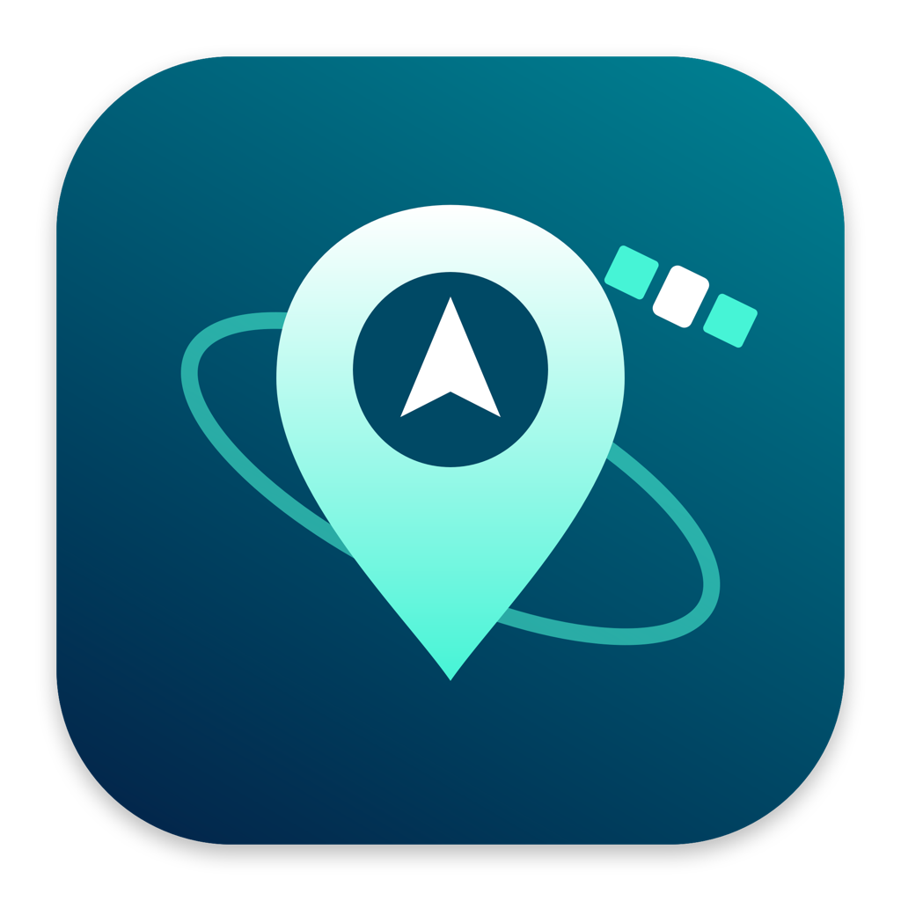
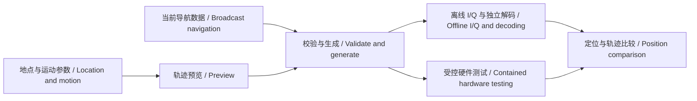

<p align="center"></p>

# 天书 Tianshu · HackRF GNSS Lab

**GPS / 北斗信号模拟、自然运动轨迹、地图选点与独立接收验证工具。**
**A macOS and Android workspace for GPS / BeiDou signal simulation, motion scenarios, maps and receiver validation.**

[中文介绍](#中文介绍) · [English](#english) · [安装 / Installation](#安装--installation) · [技术来源 / Credits](docs/THIRD_PARTY.md) · [原版 HackRF 文档 / Upstream HackRF](docs/HACKRF-UPSTREAM.md)

> 公开源码开发版，分支 `codex/public-edition`。不是 Great Scott Gadgets 官方 GNSS 产品，也不是开箱即用的认证信号源。当前没有预编译安装包。
>
> Public source development edition. This is an independent HackRF fork, not an official Great Scott Gadgets GNSS product or a calibrated signal generator. No prebuilt installers are currently provided.

## 中文介绍

### 这个项目能做什么？

天书把 GNSS 信号生成、导航数据准备、运动轨迹、地图选点、HackRF 控制和接收结果展示放到同一个工作流中，供接收机开发、离线算法研究和受控实验使用。包含三个主要部分：

| 组件 | 能力 | 环境 |
| --- | --- | --- |
| macOS 桌面端 | 地点管理、轨迹预览、GPS / 北斗选择、参数与状态展示、HackRF 检测、生成/验证流程、本机 GNSS-SDR NMEA 结果显示 | macOS 14+，Apple Silicon |
| Android 控制端 | 手机独立下载导航数据、原生生成器、USB OTG 直连 HackRF、场景导入、前台任务、停止与传输诊断、地图选点 | Android 8+，生成器目前构建 arm64-v8a；需要 USB Host |
| Android 接收工具 | 记录 GNSS 位置、卫星、NMEA 等接收信息，为目标轨迹与实测位置比较提供数据 | Android 8+；实际字段取决于设备与系统权限 |

### 信号与功能边界

| 能力 | 当前公开源码状态 |
| --- | --- |
| GPS L1 C/A | 桌面与 Android 已集成；单系统流式路径使用 2.6 Msps |
| 北斗 B1I | 桌面与 Android 已集成；单系统流式路径使用 5 Msps |
| GPS＋北斗 B1I | 包含双生成器、混频与有界流式传输实现；必须单独验证本机性能、解码和实际接收，不能由单系统结果推断通过 |
| B1C | 仅保留研究代码；当前研究实现有明确波形和独立解码限制，不作为完整 B1C 能力宣传 |
| Galileo / GLONASS | 保留部分研究代码，产品入口已取消；不属于当前支持范围 |
| 任意设备精度保证 | 不提供；地图预览、USB 发送完成和接收机成功定位是不同结果 |

**干净克隆后的重要限制：** 桌面实时发送会检查 `research/output/mixed-qualification-current.json` 及其引用文件的 SHA-256、离线解码和定位证据。这些开发机记录不随公开版发布，因此安装成功、界面能打开，不代表实时发送已经具备运行条件。先完成生成器构建与本机独立验证；缺少证据时应保留拒绝运行行为，不能靠关闭检查或伪造 JSON 解锁。Android 的流式实现也需要在自己的硬件上独立验收。

### 轨迹、地点与地图

- 支持散步、办公室、沿路行走、随意游走，以及保留的静止、直线、绕圆等模型。办公室模型以久坐和偶尔短距离移动为目标，不把突然跳点当作自然运动。
- 轨迹包含速度、方向、高度变化、随机种子、起始偏移及水平/垂直漂移；共享配置用于对齐桌面端和 Android。信号环境包括开阔区域、树荫、建筑旁和办公室；这些是模型，不是实地测量或标定后的传播环境。
- 仅内置**白宫、唐宁街10号、国会山**三个公开示例。坐标和参考高度是演示近似值；地点名称不意味着项目与相应机构有关联。用户可自行新增、修改、删除地点。
- 地图默认视野为白宫；未选点时不自动设置接收器目标。默认离线坐标网格；可加载 **OpenStreetMap**，不需要 Key。可选**高德地图**，使用用户自己的 Key。桌面文字地址查找使用系统 Apple 地图服务。
- macOS 地图海拔按 EGM2008 通过 `h = H + N` 转成椭球高，再生成 GPS、北斗共用的 ECEF 轨迹；模型离线附带，显示换算值。Android 原生轨迹暂不包含此换算，仍需输入椭球高。模型与局限见 [高程模型说明](shared/geoids/README.md)。
- 模拟以 WGS-84 为基准；高德 GCJ-02 选点需要坐标转换，存在转换和地图数据误差。

### 北斗能力来自哪里？

**北斗信号生成核心来自 [globsky/SignalSim](https://github.com/globsky/SignalSim)，原作者 Jun Mo。** 本仓库固定使用 `baba9deb68ed193efb9fd9a362b431ae8c491fa4`，通过 `research/build_bds_generator.py` 从固定源码生成补丁副本，不直接改写上游子模块。

本项目的集成工作包括：B1I 场景配置、当前广播导航数据获取与校验、BDS 导航头/电离层模型处理、连续运动输入、桌面与 Android 构建、GPS/北斗混合管线、流量控制、诊断与来源哈希记录。具体补丁见构建脚本及生成的 `provenance.json`。**这些集成不代表本项目从零实现了北斗信号体制，也不代表 SignalSim 支持的所有功能都已经在天书中验证。**

GPS 核心来自 [osqzss/gps-sdr-sim](https://github.com/osqzss/gps-sdr-sim)；硬件访问依赖 [Great Scott Gadgets HackRF](https://github.com/greatscottgadgets/hackrf)；独立软件接收验证使用 [GNSS-SDR](https://gnss-sdr.org/)。导航数据来源配置见 [`shared/navigation-sources.json`](shared/navigation-sources.json)，包含 NOAA、北斗相关公开数据源、BKG / IGS 和 Geoscience Australia 镜像。数据可用性和覆盖时段仍需运行时验证。

完整来源、固定版本、版权与许可边界见 [THIRD_PARTY.md](docs/THIRD_PARTY.md)。SignalSim 固定版本未附带仓库级 `LICENSE` 文件，源码保留原作者版权声明；不能把它自动视为 MIT 或把本仓库根目录许可证套用到全部依赖。

### 工作流



### 隐私与使用范围

公开版使用独立的应用标识、设置域、地图缓存和接收日志访问标识，避免与私人开发版混用。GNSS 接收器的目标纬度、经度默认为空，须手动填写或由授权控制端同步；后台也不内置目标。不提交个人地点、Key、签名密钥、设备日志、接收轨迹、堆转储、缓存和历史 APK。联网地图会把请求视野和网络信息发送到地图供应商；地点文字搜索也会联网。GitHub 账号归属仍然公开可见。

导航模拟只能用于经授权、经验证隔离的屏蔽或有线衰减实验环境。低功率、室内或车库不能代替射频隔离；本 README 不提供开放环境发射操作步骤。

## English

### What is Tianshu?

Tianshu integrates GNSS sample generation, broadcast navigation preparation, motion scenarios, map-based location selection, HackRF control and receiver-result inspection. It is intended for receiver development, offline experiments and contained laboratory work.

| Component | Capabilities | Platform |
| --- | --- | --- |
| Desktop application | Saved locations, trajectory previews, GPS / BeiDou selection, parameters and status, HackRF detection, generation/validation workflows and local GNSS-SDR NMEA display | macOS 14+, Apple Silicon |
| Android controller | Navigation downloads, native generators, direct HackRF USB OTG control, imported scenes, foreground jobs, stop/transport diagnostics and map selection | Android 8+; generators currently target arm64-v8a; USB Host required |
| Android receiver utility | GNSS location, satellite and NMEA recording for independent comparison with the scenario | Android 8+; available measurements depend on hardware and permissions |

### Supported scope

GPS **L1 C/A** and BeiDou **B1I** are integrated on both platforms. Single-system streaming uses 2.6 Msps for GPS and 5 Msps for B1I. A combined GPS+B1I pipeline is present, including mixing and bounded streaming, but combined operation requires its own throughput, decoding and receiver validation. A successful single-system run does not validate a combined run.

B1C remains research code with documented waveform and decoding limitations. Galileo and GLONASS research files remain in the repository, but their product entry points are disabled. Upstream constellation support must not be presented as validated application support. There is no universal positioning-accuracy guarantee.

**Fresh-checkout limitation:** desktop streaming verifies `research/output/mixed-qualification-current.json` and the hashes, decoding results and positioning evidence it references. Development-machine evidence is intentionally excluded from the public repository. Building and opening the app therefore does **not** establish readiness for real-time transmission. Build the generators and produce independent local validation evidence; retain the failure when evidence is absent rather than disabling checks or inventing qualification files. Android streaming also needs independent acceptance on the user's own hardware.

### Motion, locations and maps

Motion models include strolling, office behavior, roadside walking and wandering, with retained stationary, line and circle models. Parameters cover speed, heading, height variation, seeds, startup offsets and position drift. Shared policies align the desktop and Android models. Open-area, tree-cover, building-edge and office signal profiles are synthetic models, not calibrated site surveys.

The only bundled examples are the **White House, 10 Downing Street and Capitol Hill**. Coordinates and heights are approximate demonstration values; the names imply no affiliation. Users can manage their own locations locally.

The default map view is the White House; an unselected receiver target remains empty. The default map layer is an offline coordinate grid. **OpenStreetMap** requires no API key. **AMap/Gaode** is optional and uses the user's own credentials. Desktop text search uses Apple's map service. On macOS, EGM2008 map/orthometric heights are converted with `h = H + N` before the shared GPS/BDS ECEF trajectory is generated. The grid is bundled for offline use. Android native trajectories do not yet perform this conversion and require ellipsoidal-height input. See the [grid notes and limitations](shared/geoids/README.md). Simulation coordinates use WGS-84; GCJ-02 map selections require conversion and have conversion/data limitations.

### Where does BeiDou support come from?

**The BeiDou signal-generation core comes from [SignalSim](https://github.com/globsky/SignalSim), authored by Jun Mo**, pinned at `baba9deb68ed193efb9fd9a362b431ae8c491fa4`. `research/build_bds_generator.py` produces a patched build copy while leaving the pinned submodule intact.

This project adds B1I scenario configuration, current navigation retrieval and validation, navigation-header and ionosphere handling, continuous motion input, macOS/Android integration, combined GPS/BeiDou streaming, diagnostics and provenance hashes. The build script and generated `provenance.json` identify the local changes. Tianshu does not claim original authorship of the BeiDou signal core or validation of every upstream SignalSim feature.

GPS generation uses [gps-sdr-sim](https://github.com/osqzss/gps-sdr-sim); hardware access uses [HackRF](https://github.com/greatscottgadgets/hackrf); independent software reception uses [GNSS-SDR](https://gnss-sdr.org/). Public navigation providers and fallback URLs are listed in [`shared/navigation-sources.json`](shared/navigation-sources.json).

See [third-party credits and licensing notes](docs/THIRD_PARTY.md). In particular, the pinned SignalSim tree has no repository-level `LICENSE` file and retains its author's copyright notices. Do not assume it is MIT-licensed or that the root HackRF license covers every component.

### Privacy and laboratory use

Public application IDs, preferences, map caches and receiver-access identifiers are isolated from the private development edition. The GNSS receiver starts with empty target coordinates; enter them manually or synchronize an authorized scenario. The background service has no built-in target either. Personal presets, credentials, signing keys, device logs, received tracks and historical binaries are excluded. Online maps and address search contact their respective providers. The GitHub repository remains associated with its public owner account.

Use navigation simulation only in authorized, verified shielded or cabled/attenuated setups. Indoor operation or low transmit power is not proof of containment. This README intentionally does not provide open-air transmission instructions.

## 安装 / Installation

### 1. 获取源码 / Clone the public branch

```sh
git clone --branch codex/public-edition --recurse-submodules https://github.com/bh8fje/hackrf.git
cd hackrf
git submodule update --init --recursive
```

GitHub 的 ZIP 下载不包含完整子模块；推荐 Git 克隆。
GitHub ZIP downloads do not include complete submodule contents; use Git.

### 2. macOS 源码构建 / Build on macOS

需要 / Requirements:

- Apple Silicon，macOS 14+，Xcode Command Line Tools。
- Python 3.13（本地验证版本 / locally checked version），CMake、pkg-config、libusb、libomp。
- 独立解码需要额外安装 GNSS-SDR 并将 `gnss-sdr` 放到 PATH；见 [官方构建说明 / official build guide](https://gnss-sdr.org/docs/tutorials/building-gnss-sdr/)。打开界面和轨迹预览不需要接入 HackRF。

已有工具无需重复安装。使用 Homebrew 的环境可执行 / Reuse installed tools; a Homebrew setup can use:

```sh
xcode-select --install
brew install cmake pkg-config libusb libomp
python3.13 -m venv research/.venv
research/.venv/bin/python -m pip install -r research/requirements.txt

cmake -S host -B host/build
cmake --build host/build
research/.venv/bin/python research/build_generator.py
research/.venv/bin/python -c 'from research.build_bds_generator import build; build()'
research/.venv/bin/python app/build.py
open app/build/天书.app
```

`xcode-select --install` 仅在未安装时需要。生成器构建不等于完成接收验收。桌面应用依赖当前源码目录和 `research/.venv`；不要构建后移动/删除源码目录。可将应用复制到“应用程序”，但这并不是独立可移植安装包。

Run the Xcode installation step only if needed. Building generators does not qualify receiver operation. The app retains a reference to this checkout and its Python environment; keep both in place. Copying the app into Applications does not make it a standalone portable package.

### 3. Android 构建与安装 / Build and install Android apps

当前构建器运行于 macOS；只产出 arm64 原生生成器。需要 / The current build helper is macOS-oriented and builds arm64 generators. Install:

| 工具 / Tool | 版本 / Version |
| --- | --- |
| JDK | 17 |
| Gradle | 8.10.2，置于 PATH / on PATH |
| Android platform | SDK 35 |
| Android Build Tools | 35.0.0 |
| Android NDK | 29.0.14206865 |
| 其他 / Other | CMake、Python 环境、Android platform-tools / Python environment and Android platform-tools |

使用 Android Studio SDK Manager 安装上述组件，或参照 [Android SDK 管理文档](https://developer.android.com/tools/sdkmanager)。以下是常见 macOS 路径；已有配置应优先复用。

Use Android Studio's SDK Manager or the [Android SDK documentation](https://developer.android.com/tools/sdkmanager). These are conventional macOS paths; adapt them to your installation.

```sh
export JAVA_HOME="$(/usr/libexec/java_home -v 17)"
export ANDROID_HOME="$HOME/Library/Android/sdk"
export ANDROID_NDK_HOME="$ANDROID_HOME/ndk/29.0.14206865"
export PATH="$ANDROID_HOME/platform-tools:$PATH"
gradle --version

research/.venv/bin/python mobile/build.py mobile-controller --release
research/.venv/bin/python mobile/build.py --release
```

构建器在成功后打印 APK 路径。确认手机已允许 USB 调试，再安装 / The helper prints each APK path. With USB debugging authorized:

```sh
adb install -r mobile-controller/build/outputs/apk/release/*.apk
adb install -r mobile/build/outputs/apk/release/*.apk
```

分别打开“天书”和“GNSS 接收实验室”。控制端包名为 `local.hackrf.controller.public`，接收端为 `local.hackrf.receiver.public`。两者接收场景交互检查包名与签名；使用配套签名。当前 release 构建沿用本机 debug 签名，正式分发前需自行配置发布签名；仓库不携带私人签名密钥。安装旧包时若签名不同，请先备份所需数据并自行处理，勿盲目卸载。

Open **Tianshu** and **GNSS Receiver Lab**. Public package IDs are `local.hackrf.controller.public` and `local.hackrf.receiver.public`. Scenario exchange checks package identity and signing compatibility; sign the pair consistently. Release builds currently use the local debug signing configuration. Configure your own release signing before distributing binaries. Preserve needed data before resolving any existing-package signature conflict.

### 4. 地图配置 / Configure maps

**OpenStreetMap：** 不需要 Key。应用默认离线网格，点击地图“联网”启用底图。保留 OSM 署名并遵守[瓦片服务政策](https://operations.osmfoundation.org/policies/tiles/)。
**OpenStreetMap:** no key; select the online-map control to load tiles. Keep attribution and follow the [tile policy](https://operations.osmfoundation.org/policies/tiles/).

**macOS 高德 / AMap Web JS:** 创建目录，在以下文件中填写自己的 Web JS Key 与安全密钥，然后重启应用 / create this local file with your own Web JS credentials, then restart:

```sh
mkdir -p "$HOME/Library/Application Support/WalkLabPublic"
```

文件 / File: `~/Library/Application Support/WalkLabPublic/amap.json`

```json
{"key":"YOUR_WEB_JS_KEY", "securityJsCode":"YOUR_SECURITY_JS_CODE"}
```

两项均需平台颁发的32位值，不要直接使用占位符。此文件已被 Git 忽略。配置缺失或高德启动失败时使用 OSM / 离线网格。参照[高德 JS 安全密钥文档](https://lbs.amap.com/api/javascript-api-v2/guide/abc/jscode)。

Both values must be valid 32-character platform-issued values. Do not use the placeholders literally. The file is Git-ignored. Without working configuration, use OSM / the grid. See the [AMap JS security guide](https://lbs.amap.com/api/javascript-api-v2/guide/abc/jscode).

**Android 高德 / AMap Android:** 点击“填写高德 Key”，填入 Android SDK Key，并绑定包名 `local.hackrf.controller.public` 和**你自己的签名证书 SHA-1**。这不是 Web JS Key；按提示启用地图。参照[高德 Android Key 文档](https://lbs.amap.com/api/android-sdk/guide/create-project/get-key)。

Select **填写高德 Key**, enter an Android SDK key registered for `local.hackrf.controller.public` and **your own certificate SHA-1**, then enable the map. Web JS keys are not interchangeable with Android keys. See the [Android key guide](https://lbs.amap.com/api/android-sdk/guide/create-project/get-key).

### 5. 第一次使用 / First use

1. 先在没有启动射频的状态下打开界面，选择预设或自行添加地点，确认坐标系和高度。 / Open the UI without starting RF; select a preset or add a location, then confirm coordinates and height.
2. 选择 GPS、北斗或组合模式，查看轨迹预览和参数。 / Select GPS, BeiDou or the combined mode and inspect the preview.
3. 配置需要的地图服务；不填高德 Key 也可使用离线网格与 OSM。 / Configure optional maps; the grid and OSM do not require an AMap key.
4. 先完成离线生成、独立解码及位置比较；本机生成的证据与运行日志不应提交。 / Validate offline generation, independent decoding and position comparison; keep local evidence and logs out of commits.
5. 受控硬件实验另行验收供电、USB、吞吐、独立接收与停止结果。 / Qualify power, USB transport, throughput, independent reception and stop handling separately in a contained setup.

### 6. 开发检查与常见问题 / Checks and troubleshooting

```sh
research/.venv/bin/python research/test_public_release.py
research/.venv/bin/python -m unittest discover -s research -p test_amap.py
research/.venv/bin/python -m unittest discover -s research -p test_map_server.py
research/.venv/bin/python -m unittest discover -s research -p test_platform_sync.py
```

- **缺少子模块 / Missing sources:** 使用 `git submodule update --init --recursive`，不要只下载 ZIP。
- **打不开预览 / Preview fails:** 确认原源码目录仍存在、Python 依赖已安装、应用是在当前 checkout 构建。
- **北斗构建找不到 OpenMP / Missing OpenMP:** 安装 `libomp`；Apple Silicon 构建脚本会查找 Homebrew 的 `/opt/homebrew/opt/libomp`。
- **高德鉴权失败 / AMap authentication fails:** 核对 Key 类型、Android 包名与签名 SHA-1、Web JS 安全密钥，以及网络连接。
- **缺少 qualification 文件 / Missing qualification evidence:** 这是桌面发送前的证据门槛，不是应该绕过的安装错误。 / This is an evidence gate, not an installation error to bypass.
- **研究测试缺少 output 数据 / Missing research test artifacts:** 部分测试依赖本机 `research/output` 中的历史实验数据；公开版故意不包含。 / Some integration tests require local experiment artifacts intentionally excluded from this repository.

公开版已完成桌面构建自检、Android 两个应用的 Java 编译及部分地图/配置回归检查；不等于全部测试、干净机器完整安装、手机端地图或射频验收通过。
The public edition has passed desktop build/self-checks, Java compilation for both Android apps and selected map/configuration regressions. This is not a claim of full test coverage, clean-machine installation, phone map validation or RF acceptance.

## 项目结构 / Repository map

| 路径 / Path | 内容 / Purpose |
| --- | --- |
| `app/` | macOS SwiftUI app, AMap page and local proxy |
| `mobile-controller/` | Android controller, USB transport and native-generator integration |
| `mobile/` | Android GNSS receiver utility |
| `shared/` | Shared maps, signal policies and navigation-source templates |
| `research/` | Generators, motion, navigation parsing, offline checks and experiments |
| `research/gps-sdr-sim/` | Pinned GPS generator submodule |
| `research/SignalSim/` | Pinned multi-GNSS core submodule used for BeiDou |
| `host/`, `firmware/`, `hardware/` | Upstream HackRF components; see the original documentation |

示例地点来源 / Preset references: [White House](https://www.geonames.org/4140704/the-white-house.html), [10 Downing Street](https://www.latlong.net/place/10-downing-street-london-uk-32612.html), [United States Capitol](https://commons.wikimedia.org/wiki/File:United_States_Capitol,_Washington_DC.jpg).
